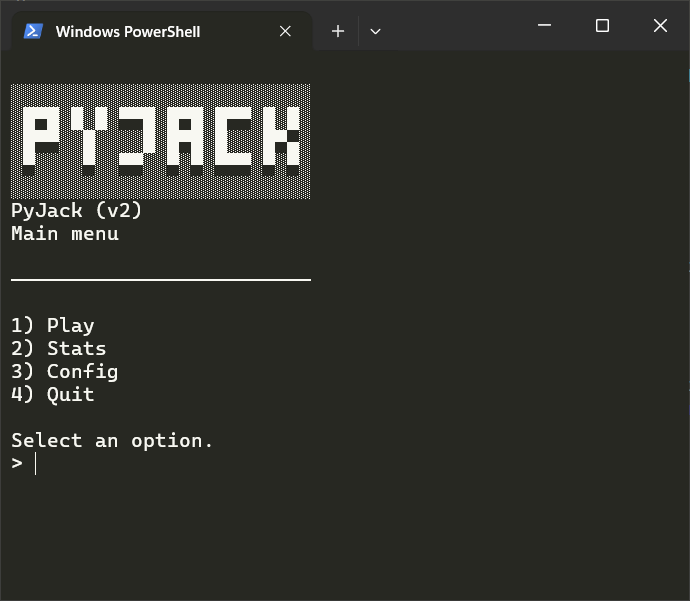
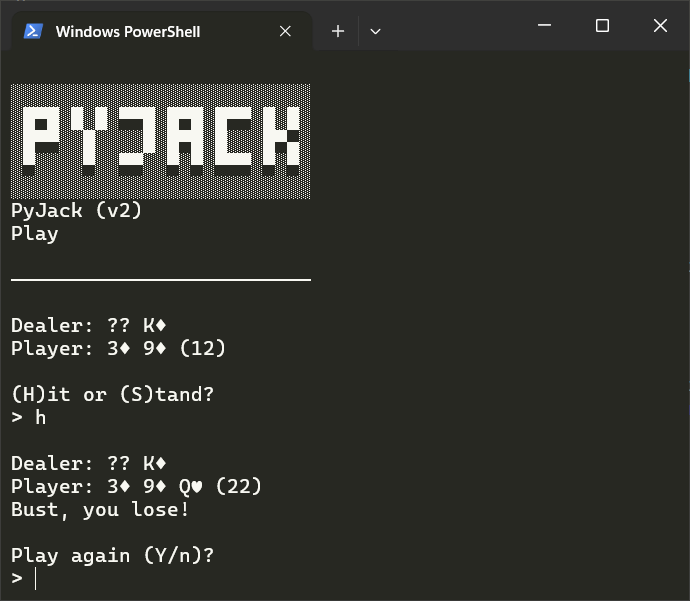
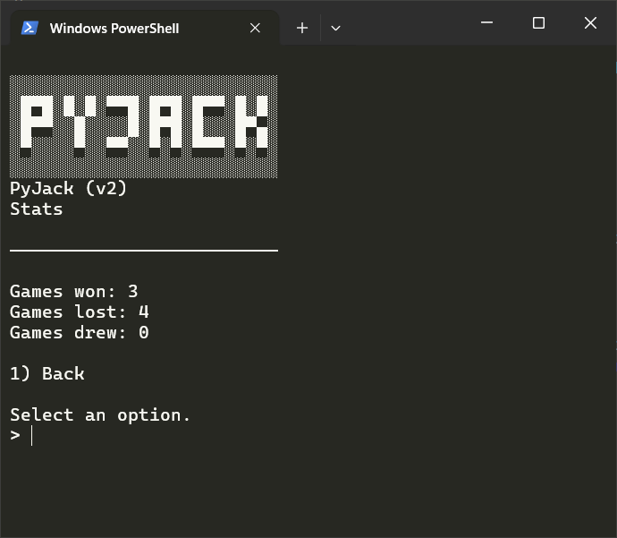
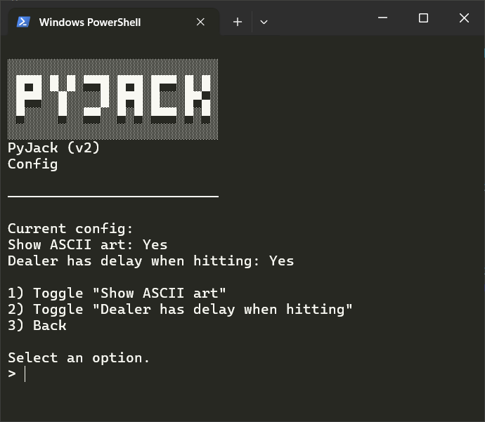

# PyJack</h1>
  
It's blackjack, but in a single Python file.  
Created for Hack Club's Stardance!  
It runs almost anywhere you can run Python (I've not tested this claim but there's nothing really stopping it!), and requires such low system specs that I think the toaster sitting in your kitchen could comfortably run it.  

# Screenshots
   
 

# How to play
1. Download Python from [this page](https://www.python.org/downloads/) if you don't already have it installed.
2. Download the latest release of PyJack from this page.
3. Run the downloaded `pyjack.py` file. All the required JSON files will be automatically created in a new `pyjack_data` directory inside the directory `pyjack.py` is inside of!
4. Play the game! Only the keyboard is required for this. You navigate around the menus using the number keys, and play the game using H and S to hit or stand. Simple!

# Why?
Why not?

# No but seriously, why?
Blackjack is a pretty good time-waster game, and for those times where you've got nothing to do, why not play some blackjack against a computer? It was also a fun challenge to test my (admittedly kind of lacking) Python skills.

# Any future plans for this?
Yes! In the future I'd like to implement a GUI of some sorts and a money system, however due to my great time management skills, I've left most of this to the last day of Stardance, therefore leaving me with no time to actually implement such features...  
If you want to have a go at implementing these yourself, why not fork this repo and see if you can add some stuff into this simple game?

# Tools I used
- Google
- ChatGPT (to fix some small bugs + help out with understanding blackjack's rules)
- Wikipedia (to copy-paste the fancy Unicode symbols used for the cards)
- VS Code (to write the damn thing)

# Something's broken?
Make a GitHub issue on [this page](https://github.com/ConsciousBone/PyJack/issues), or DM me on Slack and I'll investigate the issue as soon as possible!